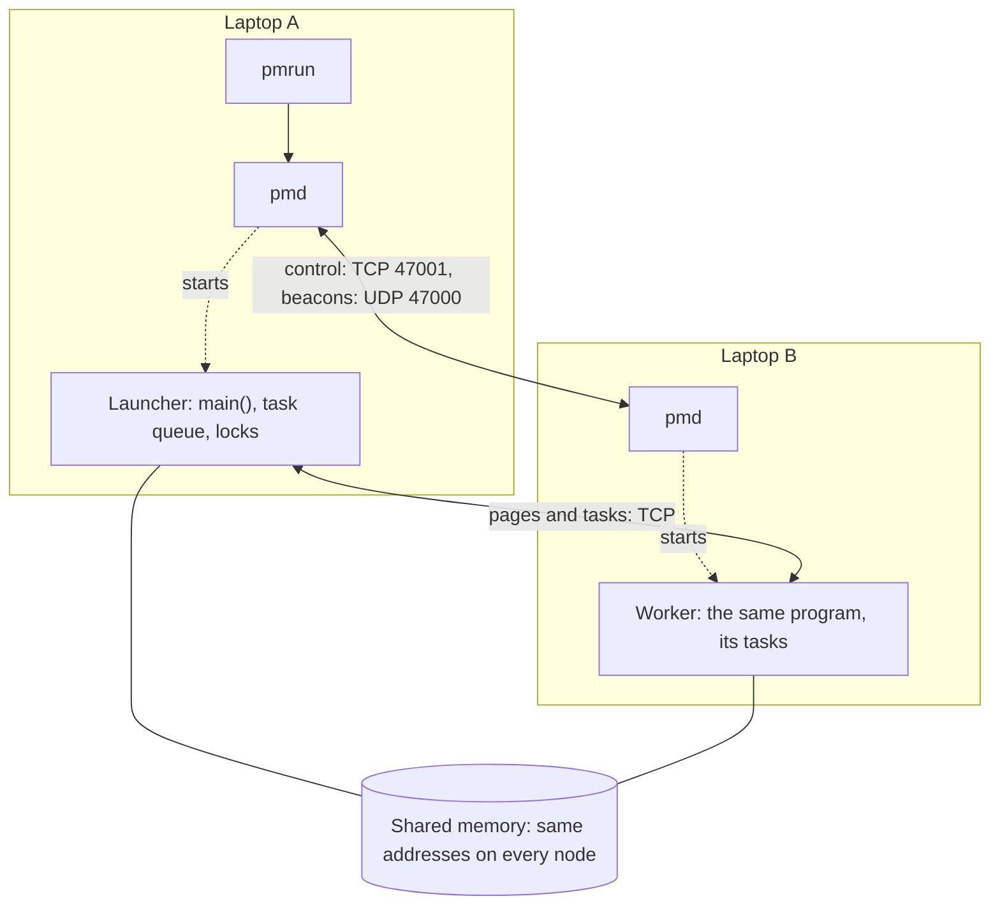
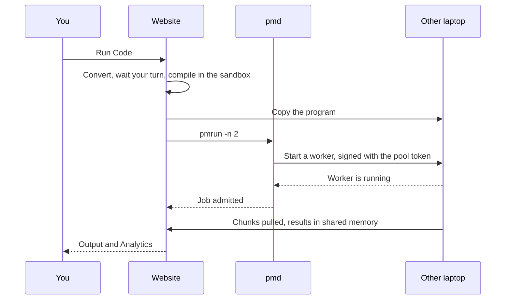
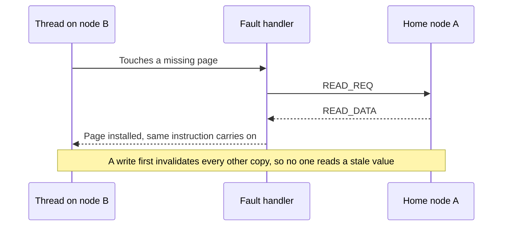
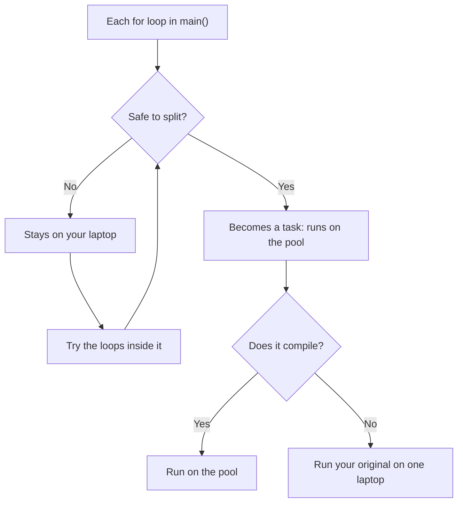
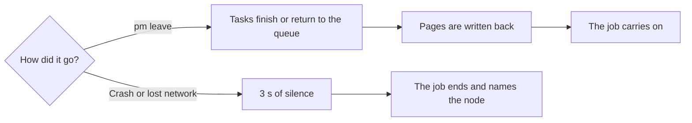

# ParaMesh

**One C program. Several Linux laptops. One shared memory.**

ParaMesh is a distributed shared-memory runtime. It lets a program use the cores and RAM of every
laptop on a network, with no socket code in the program. Memory is kept coherent by page faults: when
a program touches a page that is on another laptop, the page moves, and the program carries on.

```c
for (int i = 0; i < n; i++) {   /* plain C: the playground splits this loop across the laptops */
    a[i] = i * i;
    total += a[i];
}
```

> **Status:** a university project by Group 21. It works across two real laptops, on a network you
> trust. Read [Known limits](#known-limits) first. It is not for the internet.

## Contents

- [Why use it](#why-use-it)
- [Quick start](#quick-start)
- [How it works](#how-it-works)
- [Write a program](#write-a-program)
- [The website](#the-website)
- [Commands](#commands)
- [Features](#features)
- [Known limits](#known-limits)
- [Build from source](#build-from-source)
- [Documentation](#documentation)

## Why use it

ParaMesh suits work made of large, independent pieces: matrix work, simulations, number crunching. A
loop split across laptops can finish sooner, and a job can use more memory than one laptop has.

It does not suit small loops, or loops where every step touches the same memory. A trip over the
network costs far more than a read from RAM, so those run slower than on one laptop. Use **Compare** in
the playground to find out for your program.

## Quick start

You need Ubuntu 24.04 or newer (Linux 5.19 or later, and 6.7 or later for the playground) and
laptops that can reach each other on the network.

**1. Install on every laptop.** The same line updates later.

```bash
curl -fsSL https://github.com/Group21-Computer-Networks/Paramesh/releases/latest/download/install.sh | bash
```

Every laptop must run the same release, because a job checks that its program is identical everywhere.

**2. Install a compiler on every laptop,** for the playground.

```bash
sudo apt install -y g++
```

**3. Join the pool.** On the first laptop, open <http://127.0.0.1:47080/dashboard> and click
**Give these to the pool**. Copy the invite code it shows. On each other laptop, open the same address,
enter the code and click the same button.

**4. Check that the nodes see each other.**

```bash
pm status
```

**5. Run a job across two laptops.**

```bash
cd /opt/paramesh/apps && pmrun -n 2 /opt/paramesh/apps/matmul 512
```

It prints a checksum and `chunks by node`. Two nodes in that line means both laptops worked.

**6. Open the playground** at <http://127.0.0.1:47080/playground>, pick **Plain C, split for you**, set
Nodes to 2 and click **Run Code**. From another machine use `http://ADDRESS:47080/` and enter the access
code shown on the dashboard.

If nodes cannot see each other, a firewall is the usual cause. Allow the pool's ports on each laptop:

```bash
sudo ufw allow 47000:47081/tcp
```

```bash
sudo ufw allow 47000/udp
```

Jobs also open TCP ports chosen by the system, so on a strict firewall allow the other laptops' addresses:

```bash
sudo ufw allow from 192.168.1.0/24
```

To remove everything:

```bash
bash ~/.local/share/paramesh/paramesh-setup.sh --uninstall
```

## How it works

### The parts

Each laptop runs one daemon, `pmd`. A job is the same program on each node: the **launcher** runs
`main()`, and **workers** run its tasks.



### What happens when you run a program



### How a page moves

Every page has a **home** node that tracks who holds it. Touching a page this node lacks raises a fault
through `userfaultfd`, and the thread sleeps until the page arrives.



### How plain C is split

With Nodes at 2 or more, a program that does not call `pm_init()` goes through the translator. It splits
only what it can show to be safe.



### What happens when a laptop goes away



ParaMesh never fills lost data with zeros. It ends the job rather than give a wrong answer.

## Write a program

### Plain C, in the playground

Write ordinary C and let the translator split it. Totals are found by themselves: a variable a loop only
adds to, or only multiplies.

```c
#include <stdio.h>

int main(void) {
    long total = 0;
    for (int i = 0; i < 50000000; i++) {   /* runs on the pool */
        total += i % 7;
    }
    printf("total: %ld\n", total);         /* stays on your laptop */
    return 0;
}
```

**A loop stays on your laptop** if it:

- prints, allocates, or uses `rand()` or `break`
- needs the result of an earlier step
- writes the same place from two steps, or updates an array in place (`a[i] += x`)
- uses a struct, or calls a function that may have side effects
- is outside `main()`, is a `while` loop, or counts down

**Convert** shows the program it makes, and where each loop runs and why.

### The ParaMesh API

For full control, use `paramesh.h`:

```c
#include <paramesh.h>
#include <stdint.h>
#include <stdio.h>

struct Args { uint64_t* values; };

PM_TASK(square) {                                  /* runs on any node */
    const struct Args* a = arg;
    for (uint64_t i = lo; i < hi; i++) {
        a->values[i] = i * i;
    }
}

int main(int argc, char** argv) {
    const uint64_t count = 1000000;
    const pm_config config = {.region_bytes = 16 << 20};
    if (pm_init(&argc, &argv, &config) != PM_OK) { /* a worker never returns from here */
        return 1;
    }
    const struct Args args = {pm_malloc(count * sizeof(uint64_t))};
    pm_parallel_for("square", 0, count, 0, &args, sizeof args);
    pm_wait_all();
    printf("%llu\n", (unsigned long long)args.values[999]);
    return pm_finalize() == PM_OK ? 0 : 1;
}
```

Build it once, and copy that same file to `/opt/paramesh/apps/` on every laptop:

```bash
cc -O2 app.c $(pkg-config --cflags --libs paramesh) -o app
```

```bash
cd /opt/paramesh/apps && pmrun -n 2 /opt/paramesh/apps/app
```

A task must be safe to run twice, because a chunk runs again if its node leaves. See
[`docs/API.md`](docs/API.md).

## The website

The installer runs it on every laptop, on port 47080.

| Page | Address | What it does |
| --- | --- | --- |
| Home | `/` | What ParaMesh is, and an interactive architecture with stories to play. |
| Playground | `/playground` | Write C, Convert, Run, and Compare with one core. Live view of each node. |
| Dashboard | `/dashboard` | Join or leave, every node's CPU and RAM, credit between nodes, page ownership. |

**Access.** The laptop running the site needs no code. Other machines need the access code on its
dashboard. Each machine has one place in line, so machines take turns, and each sees and stops only its own
runs. A run may take 30 s.

**Reading a result.** **Compare** runs your program as written on one core, then across every node, and
shows the speedup and whether the outputs match. **Analytics** shows the time, who did the work, pages moved
and bytes saved. Details: [`docs/PLAYGROUND.md`](docs/PLAYGROUND.md).

## Commands

| Command | What it does |
| --- | --- |
| `pm status` | This node, its peers and the credit ledger. |
| `pm top` | Live view of jobs here. Ctrl+C quits. |
| `pm leave` | Leave the pool in order. `--force` also ends jobs this node launched. |
| `pmrun -n N PROGRAM [ARGS]` | Run a program on N nodes, 1 to 8. |
| `pmd --help` | Every daemon flag. |
| `systemctl --user status paramesh` | Is `pmd` running? |
| `systemctl --user status paramesh-site` | Is the website running? |
| `journalctl --user -u paramesh -f` | Follow `pmd`'s log. |

Run a bundled program from `/opt/paramesh/apps`: `matmul`, `quickstart`, `counter`, `sweep`, `readshare`,
`falseshare`, `faultlat`.

| Port | Used for |
| --- | --- |
| UDP 47000 | Beacons: nodes finding each other |
| TCP 47001 | Control between daemons |
| TCP 47002 | `pmd` status API and basic dashboard, this machine only |
| TCP 47080 | The website |
| Chosen by the system | Pages and tasks of a running job |

Settings go in `~/.local/state/paramesh/paramesh.conf`, one `key = value` a line. Every key is in the
Tunables table of [`docs/PLAN.md`](docs/PLAN.md).

## Features

| Area | What you get |
| --- | --- |
| Shared memory | One address space across nodes, kept coherent by page faults through `userfaultfd`. |
| Tasks | `PM_TASK`, `pm_parallel_for`, `pm_wait_all`, locks, barriers and atomic add. |
| Plain C | Safe loops split by themselves, with the converted program shown. |
| Pool | Discovery, invite codes across subnets, caps on cores and RAM, spill to disk. |
| Changing pool | A planned `pm leave`, joining a running job, optional re-homing of segments. |
| Performance | Prefetching, page diffs and compression, a hold window against page fights. |
| Fairness | A ledger per node weights free slots. What a peer claims never changes a weight. |
| Sharing | An access code, one line per laptop, turns between machines, private runs. |
| Safety | Compiles and jobs run in a sandbox. Only a node with the pool token can start a job. |
| Seeing it | Website, playground, live dashboard, Analytics, Compare, `pm status`, `pm top`. |

## Known limits

**Security**

- Use a network you trust. The access code and pool token cross the LAN in plain HTTP.
- A start request copied off the network can be replayed, and a job's data ports have no lock.
- A job can reach high ports on other machines. Memory is not capped per job.

**Reliability**

- A laptop that crashes ends every job using it. Only a planned leave is survived.
- A job that cannot start within 10 s ends. This has happened on a slow, overloaded test machine;
  `job.start_timeout` changes the limit.
- Some rare test failures are still unexplained. They are listed in [`docs/TODO.md`](docs/TODO.md).

**Fairness**

- Turns are per machine, so several machines can hold several places, and people behind one address share one.
- Each laptop's site has its own line. Between laptops, the ledger is fair by node, not by person.

**Translator**

- It reads C with patterns, not a parser. Unusual pointer tricks could get past it.
- A split program gets 512 MB of shared memory by default (`--region-mb` on the server).
- A `double` total can differ in its last digits between runs.

**Measured results**

- Speedup on two real laptops has not been recorded yet: that gate check was waived. See
  [`docs/logs/M3-gate.md`](docs/logs/M3-gate.md).

## Build from source

Needs Linux 5.19 or later, CMake 3.25+, Ninja, and GCC or Clang with C++20. The vendored headers are
committed, so a clean clone builds with nothing to download.

```bash
cmake --preset dev && cmake --build --preset dev && ctest --preset dev
```

| Preset | What it is |
| --- | --- |
| `dev` | Debug build |
| `asan`, `ubsan`, `tsan` | The same under a sanitizer |
| `tidy` | Clang build with clang-tidy; any finding fails it |

Test the website end to end:

```bash
bash tests/multi/run_playground.sh build/dev
```

Build your own installer. Give that one file to every laptop:

```bash
bash tools/setup/package.sh
```

A tag `v*` publishes a release: GitHub builds the installer on Ubuntu 24.04.

## Documentation

| Document | For |
| --- | --- |
| [`docs/API.md`](docs/API.md) | Using ParaMesh: every function of `paramesh.h` |
| [`docs/PLAYGROUND.md`](docs/PLAYGROUND.md) | The website, the sandbox and what it does not stop |
| [`docs/STATUS_API.md`](docs/STATUS_API.md) | `pmd`'s status API |
| [`docs/PROTOCOL.md`](docs/PROTOCOL.md) | Every message on the wire |
| [`docs/STATE_MACHINES.md`](docs/STATE_MACHINES.md) | The coherence state machines |
| [`docs/INTERNAL_API.md`](docs/INTERNAL_API.md) | Interfaces between source directories |
| [`docs/PLAN.md`](docs/PLAN.md) | The implementation plan and tunables |
| [`docs/TODO.md`](docs/TODO.md) | Deferred work and open failures |
| [`docs/logs/`](docs/logs/) | What was built and how it was checked |
| [`AGENTS.md`](AGENTS.md) | Guide for contributors and coding agents |
| [`third_party/`](third_party/) | Vendored libraries, versions and licences |
