<div align="center">

# ParaMesh

**One C program. Several Linux laptops. One shared memory.**

[](https://github.com/Group21-Computer-Networks/Paramesh/actions/workflows/ci.yml)
[](https://github.com/Group21-Computer-Networks/Paramesh/releases/latest)


A distributed shared-memory runtime that lets an ordinary C program use the cores and memory of every
laptop on a network, with no network code in the program.

[Quick start](#quick-start) · [How it works](#how-it-works) · [Features](#features) ·
[API](#the-paramesh-api) · [Website](#the-website) · [Results](#results) · [Build](#build-from-source)

</div>

---

```c
for (int i = 0; i < n; i++) {   /* plain C: the playground spreads this loop across the laptops */
    a[i] = i * i;
    total += a[i];
}
```

Every laptop sees the same shared memory at the same address. When a thread touches a page that lives
on another laptop, Linux pauses it, ParaMesh fetches the page over TCP, and the thread carries on as if
the page had been there all along. Loops are cut into chunks that idle laptops ask for, and a credit
ledger gives more help to laptops that have given more.

> [!NOTE]
> A university project by Group 21 for Computer Networks (CSC-303) at IIT Roorkee. It runs on real
> laptops, on a network you trust. Read [Known limits](#known-limits) before you use it.

## Contents

- [Highlights](#highlights)
- [Quick start](#quick-start)
- [How it works](#how-it-works)
- [Features](#features)
- [The ParaMesh API](#the-paramesh-api)
- [Plain C, without the API](#plain-c-without-the-api)
- [The website](#the-website)
- [Commands, ports and settings](#commands-ports-and-settings)
- [Results](#results)
- [Compared with similar systems](#compared-with-similar-systems)
- [Known limits](#known-limits)
- [Build from source](#build-from-source)
- [Project layout](#project-layout)
- [Testing](#testing)
- [Documentation](#documentation)
- [Team](#team)

## Highlights

| | |
| --- | --- |
| **Shared memory across laptops** | Up to 4 GB at one address on every laptop, kept consistent page by page: many readers or one writer. |
| **No kernel module, no root** | Built on Linux's `userfaultfd`, so it runs as an ordinary user on an ordinary laptop. |
| **Plain C from a browser** | Paste C into the playground; a translator spreads its safe loops across the pool. |
| **A pool that builds itself** | Laptops find each other by UDP; an invite code joins one from another subnet. |
| **Fair, and hard to cheat** | Credit comes only from each laptop's own measurements; what others claim is shown, never trusted. |
| **Six adaptive speed features** | Prefetching, smaller transfers, a hold window, locality scheduling, moving homes, a cost-aware cache. |
| **Safe by default** | Lost data is never replaced with zeros; visitors' code runs in a Landlock and seccomp sandbox. |
| **One-line install** | A checksummed installer that starts `pmd` and the website as services. |

## Quick start

You need Ubuntu 24.04 or newer (Linux 5.19 or later, and 6.7 or later for the playground's sandbox) and
laptops that can reach each other.

**1. Install on every laptop.** The same line updates later.

```bash
curl -fsSL https://github.com/Group21-Computer-Networks/Paramesh/releases/latest/download/install.sh | bash
```

Every laptop must run the same release, because a job checks that its program is identical everywhere.

**2. Install a compiler on every laptop,** for the playground.

```bash
sudo apt install -y g++
```

**3. Join the pool.** On the first laptop, open <http://127.0.0.1:47080/dashboard> and click
**Give these to the pool**. Copy the invite code it shows. On each other laptop, open the same address,
enter the code and click the same button.

**4. Check that the laptops see each other.**

```bash
pm status
```

**5. Run a job across two laptops.**

```bash
cd /opt/paramesh/apps && pmrun -n 2 /opt/paramesh/apps/matmul 512
```

It prints a checksum and `chunks by node`. Two nodes in that line means both laptops worked.

**6. Open the playground** at <http://127.0.0.1:47080/playground>, pick **Plain C, split for you**, set
Nodes to 2 and click **Compare**. From another machine use `http://ADDRESS:47080/` and enter the access
code shown on the dashboard.

<details>
<summary><b>Firewall, and removing ParaMesh</b></summary>

If laptops cannot see each other, a firewall is the usual cause. Allow the pool's ports on each laptop:

```bash
sudo ufw allow 47000:47081/tcp
```

```bash
sudo ufw allow 47000/udp
```

Jobs also open TCP ports chosen by the system, so on a strict firewall allow the other laptops' addresses:

```bash
sudo ufw allow from 192.168.1.0/24
```

To remove everything:

```bash
bash ~/.local/share/paramesh/paramesh-setup.sh --uninstall
```

</details>

### Container image

ParaMesh is also published on GitHub Packages as a container image with the same files as the installer:

```bash
docker pull ghcr.io/group21-computer-networks/paramesh:latest
```

```bash
docker run -d --name paramesh --network host --init ghcr.io/group21-computer-networks/paramesh
```

It starts `pmd` in standby and the website on port 47080. Host networking is needed, because discovery
uses UDP multicast and jobs open TCP ports of their own. Run commands inside it with
`docker exec paramesh pm status` or `docker exec paramesh pmrun -n 2 /opt/paramesh/apps/matmul 512`.
Every laptop must run the same image tag.

## How it works

### The parts

Every laptop runs one service, `pmd`, for the slow work: finding laptops, deciding whether to take part in
a job, starting workers, keeping the credit ledger. A **job** is the same program on every laptop: the
**launcher** runs `main()`, and **workers** run chunks of its loops. The job's copies talk to each other
directly, over a TCP mesh, to move pages and hand out work.

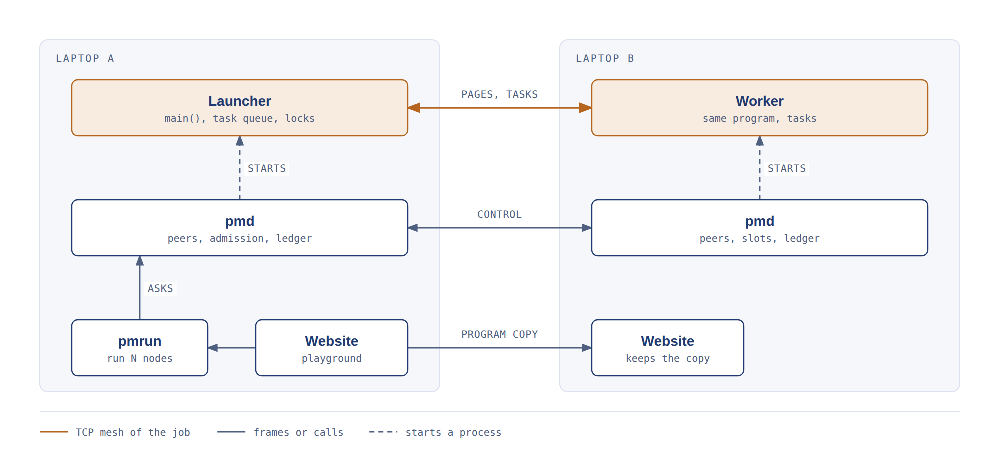

### Step by step

1. **Install.** One command installs to `/opt/paramesh` and starts `pmd` and the website as services.
2. **Discover.** Every `pmd` announces itself once a second over UDP and lists the laptops it hears.
3. **Join.** Each laptop chooses the cores and memory it gives; a laptop on another subnet uses an invite code.
4. **Write a program,** with the ParaMesh API or as plain C in the playground.
5. **Admit.** Laptops with room agree to take part, after checking the pool key and that their copy of the program is identical.
6. **Set up shared memory.** Every copy reserves the same address range, connects to the others and receives the map of segment homes.
7. **Run.** The loop is cut into chunks; threads on every laptop ask for chunks, preferring those whose data they hold.
8. **Share pages.** A thread that touches a missing page is paused while the page is fetched; a write first gets permission from the page's home.
9. **Finish.** `main()` prints the result, the job ends everywhere, and credit is recorded.
10. **Watch.** The dashboard, `pm top` and the playground's Analytics show who did the work and what moved.

### Starting a job

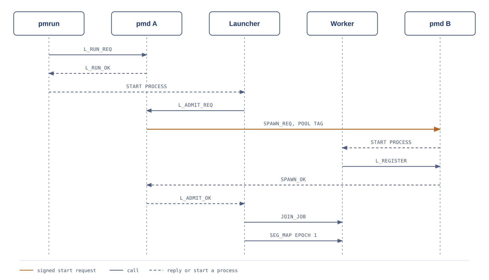

### Fetching a page

A page this laptop does not hold is not mapped. Touching it raises a fault through `userfaultfd`; the
fault-handler thread passes it to the network thread, which asks the page's **home**. When the page
arrives it is placed in memory and every thread waiting for it resumes.

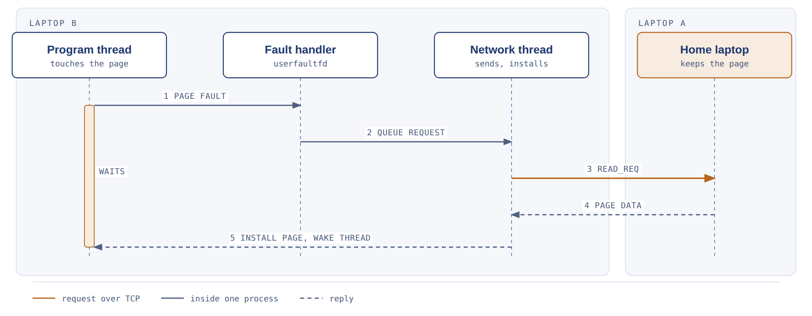

### Keeping shared data correct

Each laptop sees a page as **I** (not here), **S** (read-only) or **M** (writable), plus short waiting
states. Before a laptop may write, the home removes every other copy and waits for each to confirm.

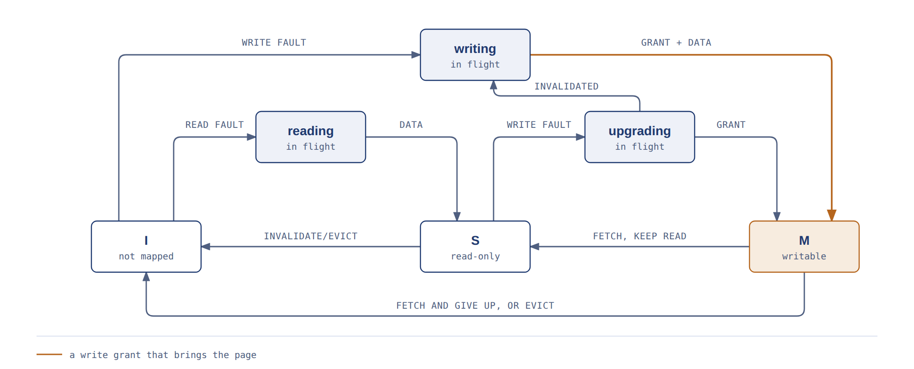

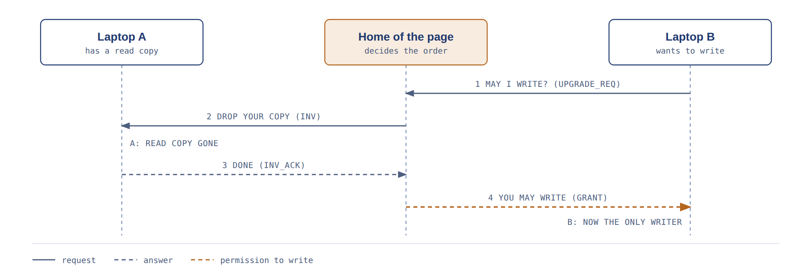

The home handles one request per page at a time and queues the rest. A writer that gives a page up first
blocks further writes, sends the page home and waits for the home to confirm, so no write is lost on the way.

### Who is in charge of each segment

Shared memory is cut into 2 MiB segments. A hash gives each laptop segments in proportion to the memory it
gives, so every laptop computes the same map with no messages, and a leaving laptop moves only its own.

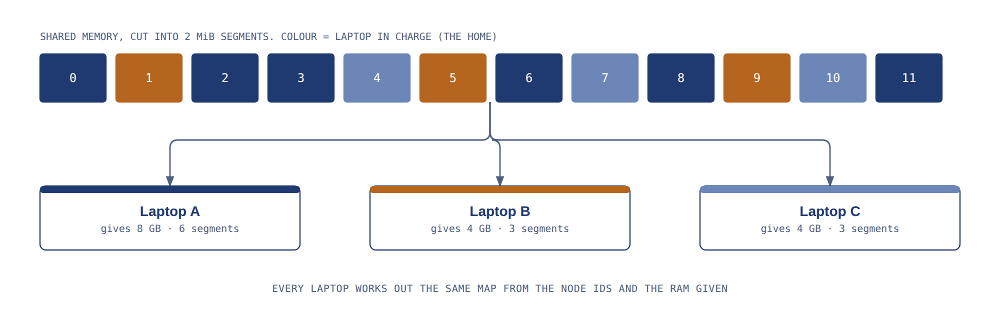

### Channels between laptops

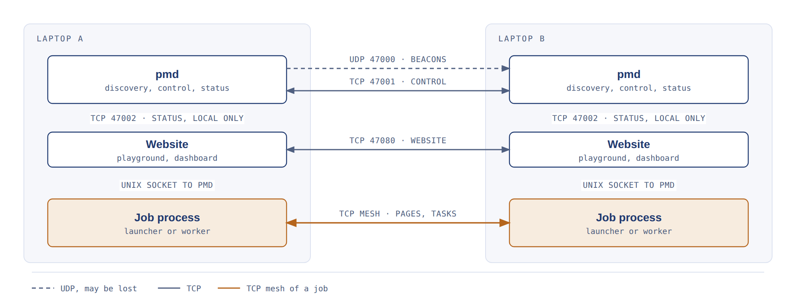

Every message starts with the same 36-byte header, checked on arrival:

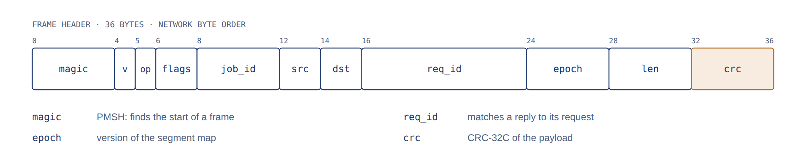

A request must be answered within 2 s (it is sent once more), and a connection silent for 3 s means the
other laptop is gone. Every message type is in [`docs/PROTOCOL.md`](docs/PROTOCOL.md), and a Wireshark
dissector in [`tools/dissector/`](tools/dissector/) decodes them all.

### When a laptop leaves or disappears

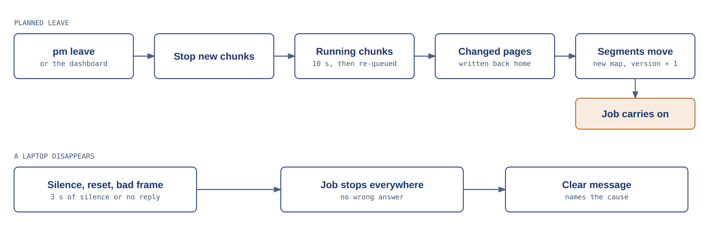

ParaMesh never fills lost data with zeros or a stale copy. A planned leave hands everything over and the
job carries on; a laptop that vanishes stops the job with a message naming it.

## Features

### Shared memory

| Feature | What it does |
| --- | --- |
| Shared region | Up to 4 GB at one fixed address on every laptop; 4 KB pages, 2 MiB segments |
| Write-invalidate consistency | Many readers or one writer per page, ordered by the page's home |
| `pm_touch` | Brings a range in before a system call such as `read()` uses it |
| Memory caps | `--cap-ram` split 75% for pages this laptop is home for, 25% for copies of others' pages |
| Spill to disk | CLOCK moves cold home pages to a spill file, on a thread of its own; a job can exceed the pool's RAM |
| Cache policy | FIFO by default, or `cache.policy = cost`: drop the cheapest of the 8 oldest copies |

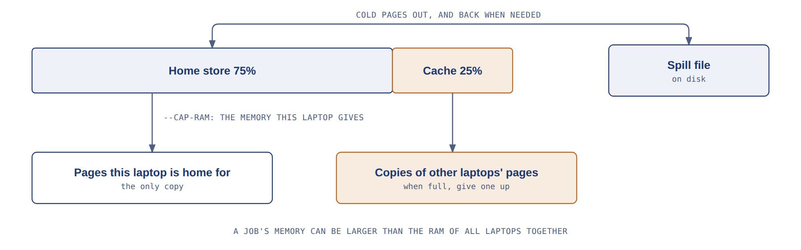

### The pool

| Feature | What it does |
| --- | --- |
| Discovery | `HELLO` every second by UDP multicast and to seeds; doubtful after 3 missed, removed after 5 |
| Across subnets | A laptop answers a new one directly; invite codes carry address, port and a short key |
| Standby | A fresh install hears the pool but takes no work until it joins from the dashboard |
| Admission | Each laptop commits its share of the job's memory, keeping 10% spare; a job that cannot fit is refused at the start |
| Same program | Every laptop hashes its copy of the program (SHA-256) and refuses a mismatch |
| Planned leave | `pm leave`: chunks get 10 s, changed pages go home, segments move under a new map; the job carries on |
| Mid-run join | A job short of laptops invites a new one, which joins holding copies only |
| Safe stop | Silence, a reset, a bad frame or no reply stops the job everywhere with the cause |

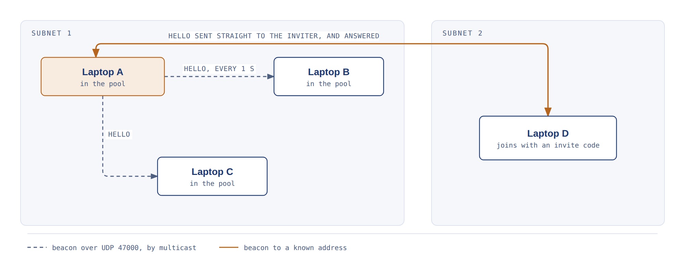

### Running the work

| Feature | What it does |
| --- | --- |
| Chunks | A loop is cut into about four chunks per thread, on page boundaries where the data allows |
| Pull, don't push | Threads ask for chunks, so a faster laptop simply asks more often |
| Chunk prefetch | A thread keeps one extra chunk ready |
| Locality | A laptop gets the chunk with most pages homed on it, or helps the longest queue |
| Locks and barriers | Kept by the launcher, served first come first served, one message each |
| Atomic add | Done at the page's home, without moving the page |
| Fair sharing | Credit from own records → weight `max(0.25, 1 + balance / 3600)` → worker threads |

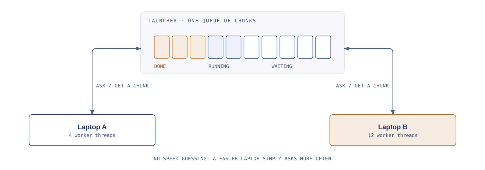

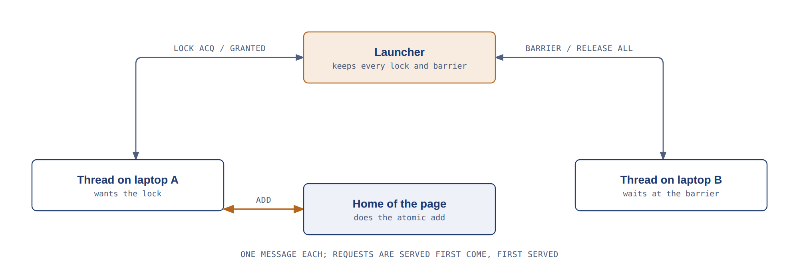

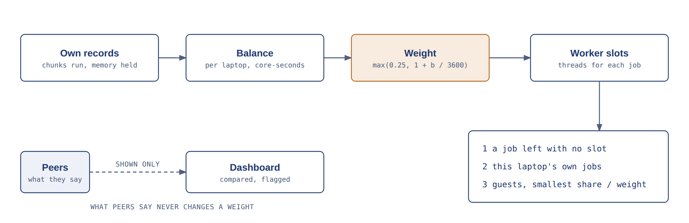

A laptop's worker threads go first to a job left with none, then to its own jobs, then to the guest job
with the smallest share for its weight. What other laptops announce is shown and compared, and never
changes a weight, a share or an admission decision.

### Making it fast

| Feature | Setting | What it does |
| --- | --- | --- |
| Prefetching | `prefetch.depth` (8), `prefetch.streams` (4) | After three faults an equal step apart, fetches the next pages at that step; each right guess doubles how far ahead |
| Smaller transfers | `page.encoding` (`auto`) | Sends a page as its non-zero words, or as only the words that changed since a kept copy, whichever is smallest; CRC-checked |
| Hold window | `thrash.*` | After 8 moves of a page in 100 ms, the owner keeps it 1 ms, doubling to 64 ms |
| Locality scheduling | `task.affinity` (2) | Sends each chunk to the laptop that holds its pages |
| Moving homes | `rehome.period_ms` (off) | A segment one laptop uses for 60% or more of its requests moves there |
| Cost-aware cache | `cache.policy` (`fifo`) | Keeps pages that come back and pages that were changed |

<table>
<tr>
<td>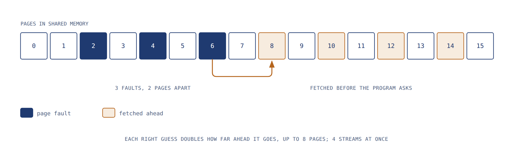</td>
<td>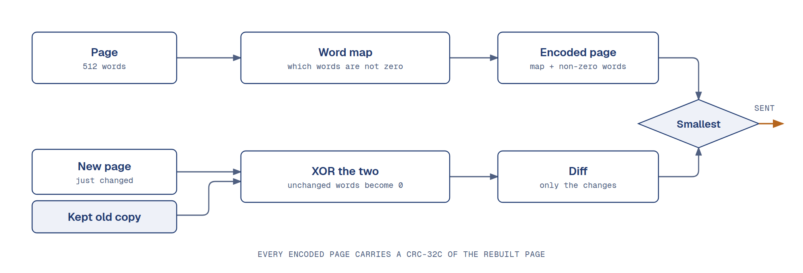</td>
</tr>
<tr>
<td>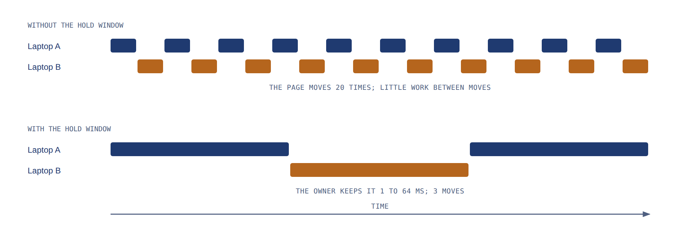</td>
<td>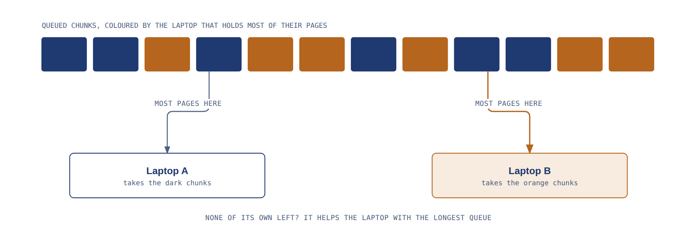</td>
</tr>
</table>

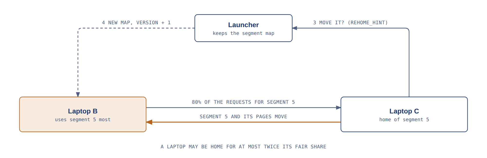

### Safety

| Feature | What it does |
| --- | --- |
| Pool key | Every start request carries a SHA-256 tag made with the pool's token; a laptop rejects any other |
| Sandbox | Website code runs under Landlock (its own folder, a job's own ports only), seccomp (no new processes, UDP, ptrace or namespaces) and limits (6 GiB, 120 s CPU); it does not run if any of this fails |
| Never zero-fill | A page is empty only if it was never written; lost data stops the job |

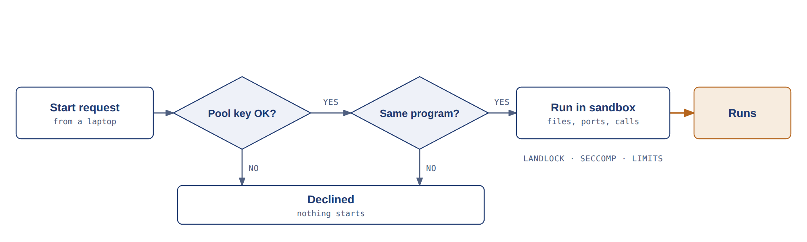

## The ParaMesh API

Everything is in one C header, [`include/paramesh.h`](include/paramesh.h), and one library,
`libparamesh`. Nothing from the C++ inside crosses the header.

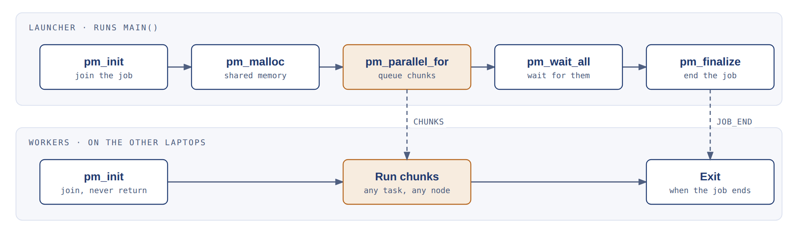

| Call | What it does |
| --- | --- |
| `pm_init(&argc, &argv, &cfg)` | Joins the job. The launcher returns and goes on; a worker runs chunks until the job ends |
| `pm_finalize()` | Ends the job on every laptop; refuses if work is still queued |
| `pm_malloc(bytes)` | Shared memory at the same address everywhere; a block of a page or more gets its own pages |
| `PM_TASK(name) { ... }` | Defines a task; its body sees `lo`, `hi`, `arg` and `ctx` |
| `pm_parallel_for(name, lo, hi, grain, arg, len)` | Queues `lo <= i < hi` as chunks; `grain` 0 means the default; `arg` up to 1,024 bytes |
| `pm_parallel_for_data(..., data, stride)` | The same, naming the shared array the range walks, for locality |
| `pm_wait_all()` | Waits for every queued chunk |
| `pm_lock_create`, `pm_lock`, `pm_unlock` | A lock across laptops |
| `pm_barrier_create(n)`, `pm_barrier_wait` | A reusable barrier for `n` threads |
| `pm_atomic_add(addr, delta)` | Adds to a shared 64-bit number pool-wide; returns the old value |
| `pm_touch(p, n, access)` | Fetches a range for reading or writing before a system call |
| `pm_strerror(code)` | Text for an error code |

`pm_config` has two fields, zero meaning the default: `region_bytes` (up to 4 GB) and
`threads_per_node`. Errors are `PM_OK` or one of eight negative codes.

```c
#include <paramesh.h>
#include <stdint.h>
#include <stdio.h>
#include <stdlib.h>

struct Args { uint64_t* values; uint64_t* total; };   /* both in shared memory */

PM_TASK(square) {                                     /* runs on any laptop, lo <= i < hi */
    const struct Args* a = arg;
    uint64_t sum = 0;
    for (uint64_t i = lo; i < hi; i++) {
        a->values[i] = i * i;
        sum += a->values[i];
    }
    pm_atomic_add(a->total, sum);                     /* last, so a re-run chunk is safe */
}

int main(int argc, char** argv) {
    const uint64_t count = argc > 1 ? strtoull(argv[1], NULL, 10) : 1000000;
    const pm_config config = {.region_bytes = count * sizeof(uint64_t) + 2 * (uint64_t)PM_PAGE_SIZE};
    if (pm_init(&argc, &argv, &config) != PM_OK) {    /* a worker never returns from here */
        return 1;
    }
    const struct Args args = {pm_malloc(count * sizeof(uint64_t)), pm_malloc(sizeof(uint64_t))};
    pm_parallel_for_data("square", 0, count, 0, &args, sizeof args, args.values, sizeof(uint64_t));
    pm_wait_all();
    printf("sum of squares: %llu\n", (unsigned long long)*args.total);
    return pm_finalize() == PM_OK ? 0 : 1;
}
```

Build it once and copy that same file to `/opt/paramesh/apps/` on every laptop:

```bash
cc -O2 app.c $(pkg-config --cflags --libs paramesh) -o app
```

```bash
cd /opt/paramesh/apps && pmrun -n 2 /opt/paramesh/apps/app
```

A task must give the same result if it runs twice, because a chunk runs again when its laptop leaves
early. Full reference: [`docs/API.md`](docs/API.md).

## Plain C, without the API

With Nodes at 2 or more, a program that does not call `pm_init()` goes through the translator. It finds
`for` loops in `main()` that are safe to spread and rewrites each as a task: arrays move to shared memory,
and a running total becomes a shared value added once per chunk. If the result does not compile, the
original runs on one laptop.

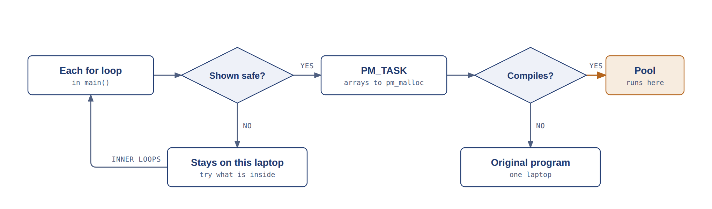

| A loop is spread if | A loop stays on your laptop if |
| --- | --- |
| It counts up: `for (i = a; i < b; i++)` | It prints, allocates, or uses `rand()` or `break` |
| Each step writes only `a[i]` at its own `i` | It reads `a[i-1]` of an array it writes |
| A total is only added to, or only multiplied | It updates an array in place, like `a[i] += x` |
| Temporary variables are set before use | It uses a struct, takes an address, or has `#` lines inside |
| Functions it calls only compute | It calls a function that might change shared data |

```c
#include <stdio.h>

int main(void) {
    long total = 0;
    for (int i = 0; i < 50000000; i++) {   /* runs on the pool */
        total += i % 7;
    }
    printf("total: %ld\n", total);         /* stays on your laptop */
    return 0;
}
```

## The website

Every laptop serves it on port 47080: a Python server using only the standard library, and plain HTML,
CSS and JavaScript.

| Page | Address | What it does |
| --- | --- | --- |
| Home | `/` | An interactive architecture: click a part, or play five stories (start a job, run a task, fetch a page, write a shared page, lose a laptop) |
| Playground | `/playground` | Write C in Monaco, then Run, Convert, Compare or Stop; live view of each laptop; Output, Converted code, Analytics and Past runs |
| Dashboard | `/dashboard` | Join or leave; every laptop's CPU and RAM; live charts; credit by laptop; laptops heard; jobs; page ownership |

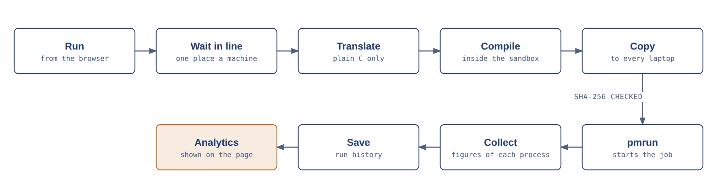

<table>
<tr>
<td>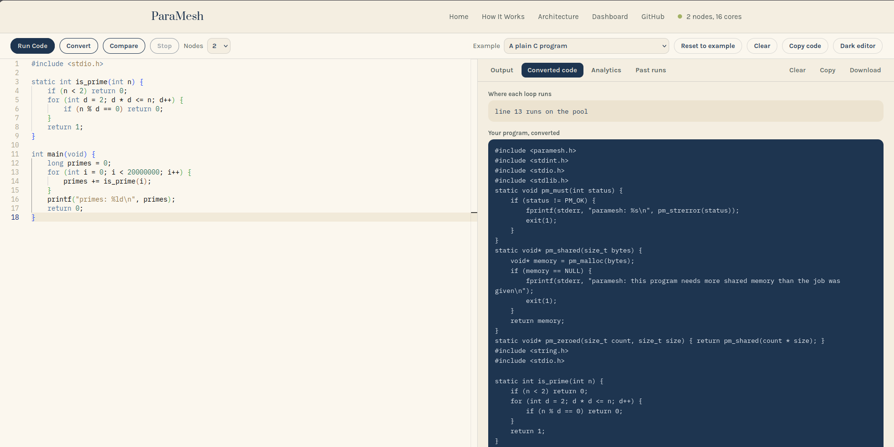<br><sub><b>Convert:</b> the translator found the total and the loop to spread.</sub></td>
<td>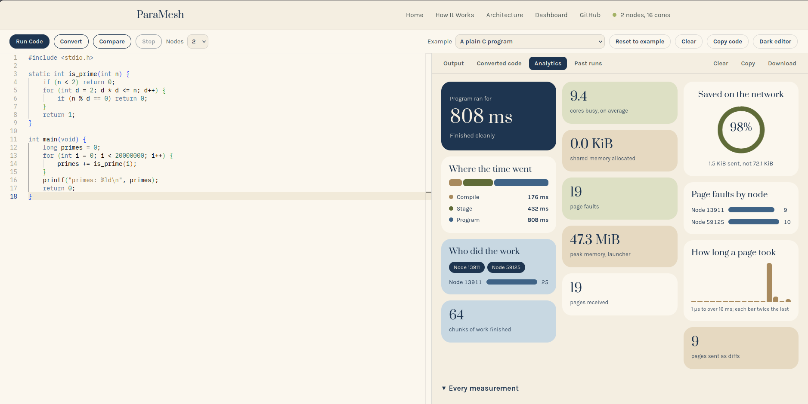<br><sub><b>Analytics:</b> a run on two laptops, 25 of 64 chunks on the second.</sub></td>
</tr>
<tr>
<td>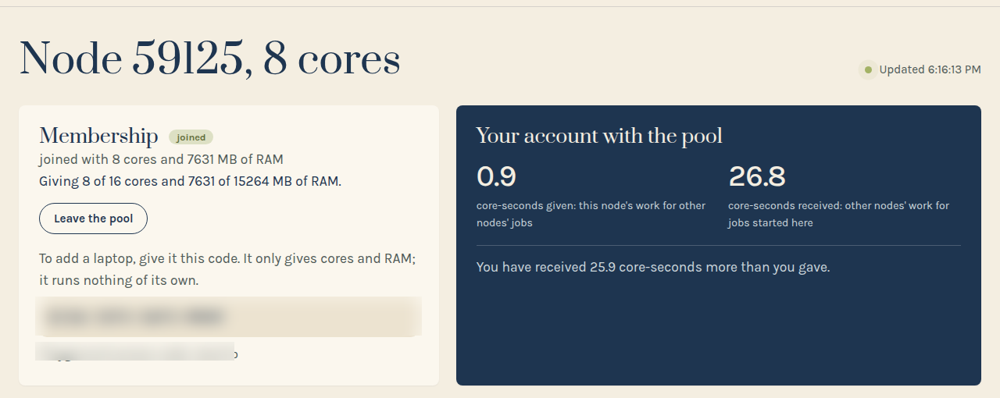<br><sub><b>Dashboard:</b> what this laptop gives, and its credit with the pool.</sub></td>
<td>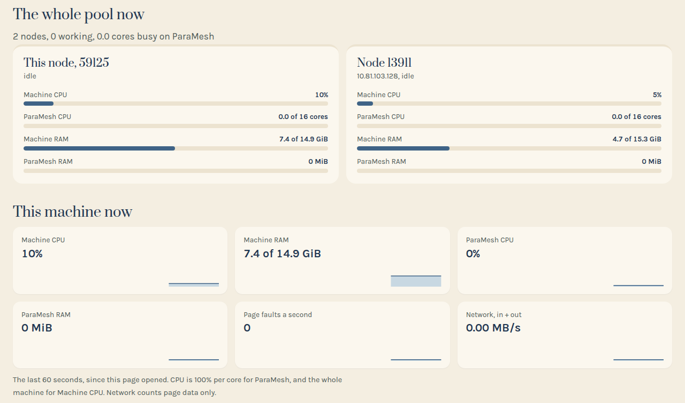<br><sub><b>Dashboard:</b> the whole pool and live charts of this machine.</sub></td>
</tr>
<tr>
<td>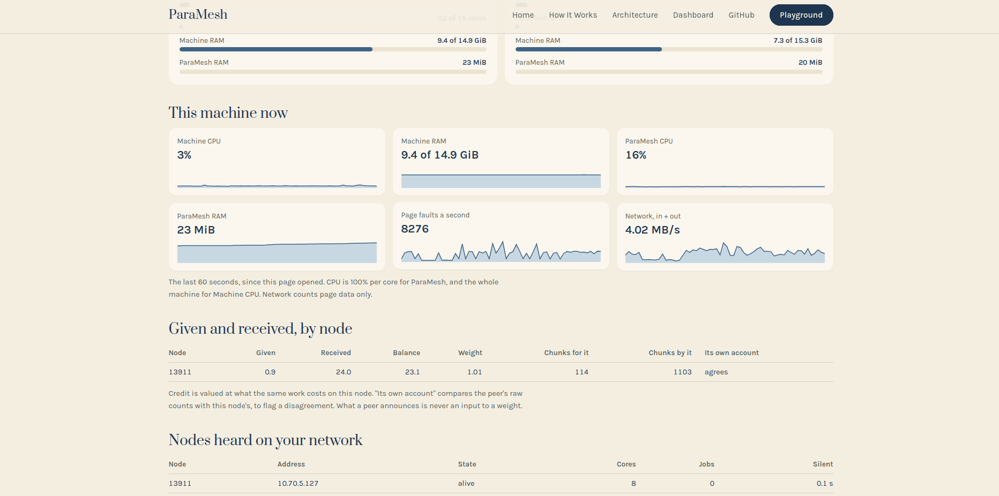<br><sub><b>During a job:</b> page faults, network use and credit, live.</sub></td>
<td>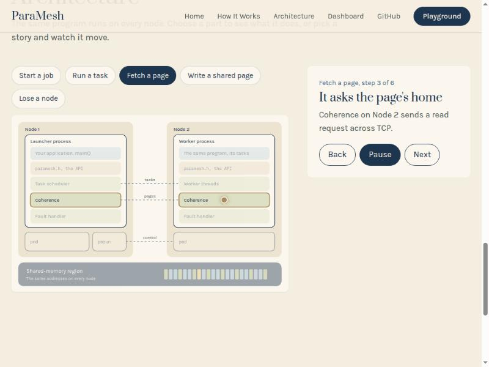<br><sub><b>Home page:</b> the story of fetching a page.</sub></td>
</tr>
</table>

**Analytics** shows where the time went (compile, staging, run), who did the work (chunks per laptop),
memory and network (faults, pages in and out, pages prefetched, encoded or sent as diffs, bytes saved),
and a histogram of how long a page took. **Compare** runs the program as written on one core and spread
on the pool, and says whether the outputs are identical.

**Access and turns.** The laptop running the site needs no code; other machines enter the access code on
its dashboard. Each machine holds one place in line and sees and stops only its own runs. A run may take
30 s. Five wrong codes from one address wait a minute. Details: [`docs/PLAYGROUND.md`](docs/PLAYGROUND.md).

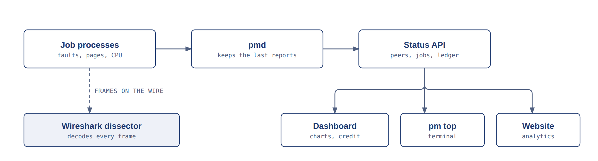

## Commands, ports and settings

| Command | What it does |
| --- | --- |
| `pm status` | This laptop, its peers and the credit ledger |
| `pm top` | Live view of jobs here; Ctrl+C quits |
| `pm leave [--force]` | Leave the pool in order; `--force` also ends jobs launched here |
| `pmrun -n N PROGRAM [ARGS]` | Run a program on N laptops, 1 to 8 |
| `pmd --help` | Every daemon flag (`--cap-cores`, `--cap-ram`, `--peers`, `--standby`, ...) |
| `systemctl --user status paramesh` | Is `pmd` running? |
| `systemctl --user status paramesh-site` | Is the website running? |
| `journalctl --user -u paramesh -f` | Follow `pmd`'s log |

Bundled programs in `/opt/paramesh/apps`: `quickstart`, `matmul`, `counter`, `sweep`, `readshare`,
`falseshare`, `faultlat`.

| Port | Used for |
| --- | --- |
| UDP 47000 | Announcements: laptops finding each other |
| TCP 47001 | Control between `pmd`s |
| TCP 47002 | `pmd`'s status API (`/v1/peers`, `/v1/jobs`, `/v1/ledger`, `/v1/events`), this machine only |
| TCP 47080 | The website |
| Chosen by the system | Pages and tasks of a running job |

Settings go in `~/.local/state/paramesh/paramesh.conf`, one `key = value` per line. Every key is in the
Tunables table of [`docs/PLAN.md`](docs/PLAN.md).

## Results

**Two real laptops over Wi-Fi**, release v0.1.2, plain C counting primes below 20,000,000:

| Run | Time | Faster than as written |
| --- | --- | --- |
| As written, one core | 6.44 s | 1× |
| Translated, one laptop | about 0.95 s | about 6.8× |
| Translated, two laptops | 0.73 s | 8.8× |

**Each speed feature against the system without it**, three laptops simulated in network namespaces:

| Feature | Workload | Without | With |
| --- | --- | --- | --- |
| Prefetching | matrix multiply, normal memory | 12.1 s, 265,856 faults | 8.4 s, 166,725 faults |
| Prefetching | matrix multiply, 1 MB cap | 17.5 s | 10.4 s |
| Smaller transfers | matrix multiply, 20 Mbit/s | 3.71 s, 10,211 KB sent | 1.11 s, 3,207 KB sent |
| Smaller transfers | `sweep`, 20 Mbit/s | 23.50 s, 95,017 KB | 12.25 s, 42,390 KB |
| Hold window | read-write fight over one page | 9.4–9.9 s, ~100,000 page moves | 0.45–0.54 s, ~100 moves |
| Locality scheduling | `sweep` | 6.28 s, 57,488 pages in | 3.63 s, 36,594 pages in |
| Locality scheduling | `sweep`, 1 ms delay | 99.6 s | 37.8 s |
| Moving homes | fight over a page homed on a third laptop | mostly 74–98 s | 22.5–28.2 s |

**Fairness**, simulated laptops: Jain's index 0.996 for three equal jobs (1.0 is perfectly fair). A laptop
that only takes saw its weight fall from 0.96 to 0.60 and its share from 0.21 to 0.14, never to 0.

ParaMesh helps most when a program does a lot of computing for each page it touches; the primes run above
moved only 19 to 37 pages in total. Every measurement and its command is in the
[implementation logs](docs/logs/).

## Compared with similar systems

| System | How work is shared | Shared memory across machines | Program changes | Finds machines itself | Fair credit | Browser playground |
| --- | --- | --- | --- | --- | --- | --- |
| **ParaMesh** | Shared memory in pages, plus tasks | Yes | None for plain C, or a small C API | Yes, plus invite codes | Yes, from own records | Yes |
| IVY | Shared memory in pages | Yes | Written for it | No | No | No |
| TreadMarks | Shared memory, multiple writers | Yes | Its API, locks and barriers | No | No | No |
| MPI | Messages sent by the program | No | Rewritten around send and receive | No (host list) | No | No |
| OpenMP | Threads on one machine | One machine only | Pragmas | — | No | No |
| Apache Spark | Data sets split across machines | No | Rewritten in Spark's API | Through a cluster manager | Job scheduler only | Monitoring UI |
| BOINC | Independent work units | No | Wrapped as work units | Central server | Yes, granted by a server | Project sites |

## Known limits

- **Use a network you trust.** Traffic is not encrypted: the access code and pool token cross the LAN in
  plain HTTP, a copied start request can be replayed, and a job's data ports have no lock.
- **A laptop that crashes ends the jobs using it.** A planned leave is survived; replicating pages to
  survive a crash is future work.
- **Page-heavy work over Wi-Fi** is limited by the round trip per page. Use **Compare** to check your program.
- **Fairness is by laptop,** and each laptop's site has its own line.
- **The translator reads C with patterns,** handles counted `for` loops in `main()`, and gives a split
  program 512 MB of shared memory by default. A `double` total can differ in its last digits.
- **Memory is not capped per job.**

Open issues are tracked in [`docs/TODO.md`](docs/TODO.md).

## Build from source

Needs Linux 5.19 or later, CMake 3.25+, Ninja, and GCC or Clang with C++20. The vendored headers are
committed, so a clean clone builds with nothing to download.

```bash
cmake --preset dev && cmake --build --preset dev && ctest --preset dev
```

| Preset | What it is |
| --- | --- |
| `dev` | Debug build |
| `asan`, `ubsan`, `tsan` | The same under a sanitizer |
| `tidy` | Clang build with clang-tidy; any finding fails it |

Test the website end to end:

```bash
bash tests/multi/run_playground.sh build/dev
```

Run the evaluation, three laptops in network namespaces (no root where unprivileged user namespaces
are allowed; `tools/check_env.sh` tells):

```bash
bash tools/bench/evaluate.sh prefetch encoding coherence sched rehome cache
```

Build your own installer, and give that one file to every laptop:

```bash
bash tools/setup/package.sh
```

A tag `v*` publishes a release: GitHub Actions builds the installer on Ubuntu 24.04 and attaches it with
its SHA-256 and the one-line `install.sh`.

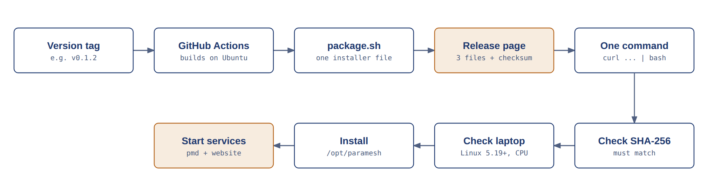

## Project layout

Each source directory is one CMake target and uses only the directories below it.

```
include/paramesh.h      the public C interface
src/platform/           logging, settings, CRC-32C, SHA-256, JSON, HTTP, clock, sandbox
src/wire/               frame header, opcodes, payloads, page encoding
src/coh/                page-sharing state machines: pure, no system calls, no clock
src/mem/                shared region and userfaultfd
src/store/              home store, spill file, local cache, segment placement
src/net/                epoll transport, TCP mesh, heartbeats, timers
src/rt/                 chunks, workers, locks, barriers, shared allocator
src/lib/                the job process: joins the above into libparamesh; prefetcher
src/pmd/                the daemon: discovery, admission, spawn, ledger, slots, status API
src/tools/              pm, pmrun, pm top
apps/                   example programs
tools/playground/       website server and plain C translator
tools/site/             website pages
tools/setup/            installer and packaging
tools/bench/            evaluation scripts
tools/dissector/        Wireshark dissector
tests/                  unit tests, fuzzer, multi-node scripts
third_party/            vendored header-only libraries
```

| Area | Lines |
| --- | --- |
| C++ in `src/` | about 15,400 |
| Tests, website, server and tools | about 14,000 |

The library is compiled with exceptions off: functions return a result or an error, and a fatal problem
stops the job with a logged reason. Logs are one JSON object per line.

## Testing

| Layer | What runs |
| --- | --- |
| Unit tests | 230 doctest cases in 13 files, built with GCC and Clang |
| Sanitizers | AddressSanitizer, UndefinedBehaviorSanitizer and ThreadSanitizer, in CI |
| Fuzzer | Three simulated laptops with random message orders; six rules checked after every step; a planted bug must be caught |
| Multi-node | Scripts on localhost and in network namespaces, with added delay and loss |
| Website | 50 end-to-end checks, and translated programs compared with a plain `gcc` build |
| Quality gate | clang-format, clang-tidy, warnings as errors; 13 required checks before any merge |

The project was built in seven milestones (M0 to M6), each closed by a review. Every change has an
implementation log in [`docs/logs/`](docs/logs/), and CI rejects a pull request whose changes are not logged.

## Documentation

| Document | For |
| --- | --- |
| [`docs/API.md`](docs/API.md) | Every function of `paramesh.h` |
| [`docs/PLAYGROUND.md`](docs/PLAYGROUND.md) | The website, the sandbox and what it does not stop |
| [`docs/STATUS_API.md`](docs/STATUS_API.md) | `pmd`'s status API |
| [`docs/PROTOCOL.md`](docs/PROTOCOL.md) | Every message on the wire |
| [`docs/STATE_MACHINES.md`](docs/STATE_MACHINES.md) | The page-sharing state machines and their rules |
| [`docs/INTERNAL_API.md`](docs/INTERNAL_API.md) | Interfaces between source directories |
| [`docs/DESIGN.md`](docs/DESIGN.md) | The design: HLD and LLD |
| [`docs/PLAN.md`](docs/PLAN.md) | The implementation plan and tunables |
| [`docs/TODO.md`](docs/TODO.md) | Deferred work |
| [`docs/logs/`](docs/logs/) | What was built and how it was checked |
| [`AGENTS.md`](AGENTS.md) | Guide for contributors and coding agents |
| [`third_party/`](third_party/) | Vendored libraries, versions and licences |

## Team

Group 21, Department of Computer Science and Engineering, IIT Roorkee. Computer Networks (CSC-303),
submitted to Prof. Sandeep Kumar.

| Member | Contribution |
| --- | --- |
| Amirishetty Sai Vignesh | Project lead; shared memory and page faults; page-sharing rules and fuzzer; release and installer; integration and testing on real laptops |
| Dakshit Tanay | Network layer: message format, TCP mesh, heartbeats, discovery, invite codes; Wireshark dissector |
| Gunakala Piyoosh Pranav | Task runtime: chunks, locks, barriers, atomic add; locality scheduling; prefetching |
| Ishaan Singh | Overall design and implementation plan; `pmd`: starting jobs, admission, credit ledger, fair sharing; leaving and joining mid-run |
| Tanish Agarwal | Website: playground, dashboard, home page; the plain C translator; sandbox |
| Vishnu | Memory beyond RAM (spill, cache policy); smaller transfers; hold window; moving homes; measurements and report |

### References

- K. Li and P. Hudak, "Memory Coherence in Shared Virtual Memory Systems," *ACM TOCS*, 1989.
- C. Amza et al., "TreadMarks: Shared Memory Computing on Networks of Workstations," *IEEE Computer*, 1996.
- D. G. Thaler and C. V. Ravishankar, "Using Name-Based Mappings to Increase Hit Rates," *IEEE/ACM ToN*, 1998.
- A. Ghodsi et al., "Dominant Resource Fairness," *NSDI*, 2011.
- R. Jain, D. Chiu and W. Hawe, "A Quantitative Measure of Fairness," DEC TR-301, 1984.
- H. Al Maruf and M. Chowdhury, "Effectively Prefetching Remote Memory with Leap," *USENIX ATC*, 2020.
- [Userfaultfd](https://docs.kernel.org/admin-guide/mm/userfaultfd.html), the Linux kernel documentation.
