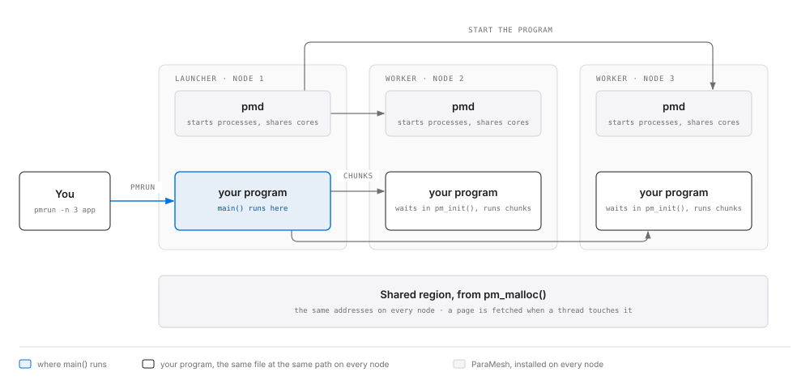

# Using ParaMesh

ParaMesh lets one ordinary C or C++ program use the cores and memory of several Linux machines
on a LAN. You write a program against one header, `paramesh.h`. Memory you allocate with
`pm_malloc()` is shared: every machine sees the same bytes at the same addresses. Work you
queue with `pm_parallel_for()` runs on whichever machines have cores free. There is no socket
code in your program.

This guide is for people who use the library. How ParaMesh is built inside (protocol, state
machines, modules) is in the [architecture documents](#architecture-documents) and is not
needed here.



*The program runs on every node of a job. Its `main()` runs on the launcher, the node where
you typed `pmrun`; on the other nodes the same program waits in `pm_init()` and runs task
chunks. Each node's `pmd` daemon starts the processes and shares out its cores.*

**Contents:** [Install and join](#install-and-join) ·
[Your first program](#your-first-program) · [Concepts](#concepts) ·
[Rules for a ParaMesh program](#rules-for-a-paramesh-program) ·
[API reference](#api-reference) · [Status codes](#status-codes) · [Tools](#tools) ·
[Settings](#settings) · [Troubleshooting](#troubleshooting)

## Install and join

Each machine needs Linux 5.19 or later. On each one:

1. Run the setup file you were given (made once with `tools/setup/package.sh`):
   ```bash
   bash paramesh-setup-<version>.sh
   ```
   It installs everything at `/opt/paramesh`, the same path on every machine, and starts the
   daemon `pmd` in **standby**: it can see the pool but gives nothing yet.
2. Open the dashboard at <http://127.0.0.1:47002/>. Choose how many cores and how much RAM to
   give, then press **Join the pool**. On a network without multicast, also type the address
   of a machine already in the pool as the lead node.
3. The dashboard shows the compute this machine has given to others and received from them,
   in core-seconds. **Leave the pool** takes the machine out again after its work is handed
   back; it returns to standby.

Machines join one pool per LAN: every daemon that can hear the others' beacons. A firewall
must allow UDP 47000, TCP 47001 and the TCP ports jobs open between the machines.

To remove ParaMesh: `bash paramesh-setup-<version>.sh --uninstall`.

## Your first program

This program squares a million numbers across the pool and adds them up. It is
[`apps/quickstart/main.c`](../apps/quickstart/main.c) in the repository and
`/opt/paramesh/apps/quickstart` once installed.

```c
#include <paramesh.h>
#include <stdint.h>
#include <stdio.h>
#include <stdlib.h>

struct Args {
    uint64_t* values; /* shared: from pm_malloc() */
    uint64_t* total;  /* shared: one number */
};

/* Runs on any node, for indexes lo <= i < hi. Safe to run twice: it overwrites its outputs,
 * and the one addition to the shared total comes last. */
PM_TASK(square) {
    const struct Args* a = arg;
    uint64_t sum = 0;
    for (uint64_t i = lo; i < hi; i++) {
        a->values[i] = i * i;
        sum += a->values[i];
    }
    pm_atomic_add(a->total, sum);
}

int main(int argc, char** argv) {
    const uint64_t count = argc > 1 ? strtoull(argv[1], NULL, 10) : 1000000;
    const pm_config config = {.region_bytes = count * sizeof(uint64_t) + 2 * PM_PAGE_SIZE};
    int status = pm_init(&argc, &argv, &config); /* a worker never returns from here */
    if (status != PM_OK) {
        fprintf(stderr, "quickstart: %s\n", pm_strerror(status));
        return 1;
    }
    const struct Args args = {pm_malloc(count * sizeof(uint64_t)), pm_malloc(sizeof(uint64_t))};
    if (args.values == NULL || args.total == NULL) {
        fprintf(stderr, "quickstart: the shared region is too small\n");
        return 1;
    }
    status = pm_parallel_for_data("square", 0, count, 0, &args, sizeof args, args.values,
                                  sizeof(uint64_t));
    if (status == PM_OK) {
        status = pm_wait_all();
    }
    if (status != PM_OK) {
        fprintf(stderr, "quickstart: %s\n", pm_strerror(status));
        return 1;
    }
    const uint64_t n = count - 1; /* 0^2 + ... + n^2 = n(n+1)(2n+1)/6 */
    const uint64_t expected = n * (n + 1) / 2 * (2 * n + 1) / 3;
    const uint64_t total = *args.total; /* read it before pm_finalize() releases the region */
    printf("sum of squares below %llu: %llu (%s)\n", (unsigned long long)count,
           (unsigned long long)total, total == expected ? "right" : "WRONG");
    return pm_finalize() == PM_OK && total == expected ? 0 : 1;
}
```

Build it **once**, copy the same file to every machine, and run it from a directory that
exists on every machine:

```bash
cc -O2 quickstart.c $(pkg-config --cflags --libs paramesh) -o quickstart
cp quickstart /opt/paramesh/apps/      # and scp it to /opt/paramesh/apps/ on the others
cd /opt/paramesh/apps
pmrun -n 3 /opt/paramesh/apps/quickstart
```

```
sum of squares below 1000000: 333332833333500000 (right)
```

The program must be the same file at the same path on every node: each node checks the
file's SHA-256 against the launcher's before running it, and refuses a different build with
"binary mismatch". A C++ program builds the same way with `c++`.

## Concepts

| Term | Meaning |
| --- | --- |
| **Pool** | The machines on the LAN whose daemons have joined. |
| **Node** | One machine in the pool, with its `pmd` daemon. |
| **Job** | One run of your program, started by `pmrun -n N`, on N nodes. |
| **Launcher** | The node where you ran `pmrun`. Your `main()` runs there, start to end. |
| **Worker** | Every other node of the job. The same program runs there, but `pm_init()` never returns: it runs task chunks until the job ends. |
| **Shared region** | The memory `pm_malloc()` hands out, up to 4 GB, at the same address on every node. It is made of 4 KB pages, grouped in 2 MB segments, each segment kept by a home node. |
| **Task** | A function defined with `PM_TASK`, which works on a range of indexes. |
| **Chunk** | A piece of a range. `pm_parallel_for()` cuts a range into chunks, and any node's worker threads may run any chunk. |

A thread that touches a page its node does not hold stops for a moment while the page is
fetched; when it writes, other nodes' copies are discarded first. You see ordinary memory.
The cost is the network: a program is fast when each chunk works mostly on its own pages.
`pm_parallel_for_data()` helps by giving each node chunks whose pages it already keeps.

## Rules for a ParaMesh program

- **What may live in shared memory:** numbers, arrays, plain structs, pointers into the shared
  region, and `pm_lock_t` / `pm_barrier_t` handles. **Not:** pointers to the local heap or
  stack, function pointers, pthread objects, C++ containers or strings. Each node has its own
  heap; only the shared region is the same everywhere.
- **The launcher does the setting up.** `pm_malloc()`, `pm_parallel_for()`,
  `pm_parallel_for_data()`, `pm_wait_all()`, `pm_lock_create()`, `pm_barrier_create()` and
  `pm_finalize()` are called from the launcher's `main()` only, never from a task.
- **A task may run twice on the same indexes.** If a node leaves before finishing a chunk, the
  chunk runs again elsewhere. Overwrite outputs, and add to a shared total only with
  `pm_atomic_add()`, as the last thing the task does.
- **Pass data to tasks through the argument.** It is copied (at most 1 KB) and each chunk gets
  the copy. Put pointers from `pm_malloc()` in it to reach shared data.
- **Hand shared memory to a system call only after `pm_touch()`.** The kernel does not fetch a
  missing shared page, so `read(fd, shared_buffer, n)` can fail with `EFAULT`.
- **Do not touch shared memory after `pm_finalize()`.** The region is gone.
- **A failure while running ends the whole job.** A lost node, a second network timeout or an
  exception thrown by a task makes every process print the reason and exit. Such failures
  never arrive as return values, and no thread ever carries on with missing data.

## API reference

Everything is declared in `paramesh.h`, which is C11 and C++20. Every function that returns
`int` returns `PM_OK` (0) or a negative [status code](#status-codes).

### Constants

| Name | Value | Meaning |
| --- | --- | --- |
| `PM_PAGE_SIZE` | 4096 | Bytes in a page of shared memory. |
| `PM_REGION_MAX_BYTES` | 4 GB | The largest shared region a job can ask for. |
| `PM_TASK_ARG_MAX` | 1024 | The largest task argument, in bytes. |

### `pm_init`

```c
int pm_init(int* argc, char*** argv, const pm_config* cfg);
```

Starts or joins the job. Call it once, first thing in `main()`, on the main thread.

| Parameter | Meaning |
| --- | --- |
| `argc`, `argv` | Those of `main()`, or both `NULL`. Reserved; not read today. |
| `cfg` | The job's settings, below, or `NULL` for all defaults. |

```c
typedef struct pm_config {
    uint64_t region_bytes;     /* shared region size; 0 = 4 GB. Rounded up to 2 MB. */
    uint32_t threads_per_node; /* most worker threads per node; 0 = what each node gives */
} pm_config;
```

- **On the launcher** it maps the shared region, asks the pool for room (each node's daemon
  checks it can commit its share of `region_bytes`), connects to the other nodes and returns
  `PM_OK` once all have joined.
- **On a worker** it does the same, then runs tasks until the job ends and exits the process.
  It never returns.

Errors (launcher only): `PM_ERR_INVALID` (a `cfg` value out of range), `PM_ERR_STATE` (called
twice), `PM_ERR_PLATFORM`, `PM_ERR_CONFIG` (not started by `pmrun`), `PM_ERR_REFUSED` (the
pool has no room; the reason is printed), `PM_ERR_NETWORK`, `PM_ERR_NOMEM`.

### `pm_finalize`

```c
int pm_finalize(void);
```

Ends the job: every worker exits and the region is released. Call it once, on the launcher's
main thread, after the last `pm_wait_all()`. Errors: `PM_ERR_STATE` (not started, called
twice, or chunks still queued).

### `pm_malloc`

```c
void* pm_malloc(size_t bytes);
```

Allocates `bytes` of shared memory and returns its address, the same on every node. It reads
as zeros until written and lasts until `pm_finalize()`; there is no `pm_free()`. An allocation
of 4 KB or more starts on a page and owns its pages, so two of them never share a page; a
smaller one is 16-byte aligned. Returns `NULL` when the region is full, when `bytes` is 0, or
when called from a task. Launcher only, and not while tasks are running.

### `PM_TASK`

```c
PM_TASK(name) { /* body */ }
```

Defines a task and registers it when the program starts. Use it at file scope. The body sees
four parameters:

| Parameter | Type | Meaning |
| --- | --- | --- |
| `ctx` | `const pm_task_ctx*` | Where it runs: `ctx->node` (node ID), `ctx->thread` (worker thread index, from 0), `ctx->arg_len`. |
| `lo`, `hi` | `uint64_t` | The indexes to process: `lo <= i < hi`. |
| `arg` | `const void*` | A private, read-only copy of the argument given to `pm_parallel_for()`. |

`ctx` and `arg` are valid only until the body returns. The task's name, for
`pm_parallel_for()`, is the macro argument as a string: `PM_TASK(square)` is `"square"`. The
function is `static`, so a name may be defined in one file only. A C++ task may throw: the job
ends, naming the task. (`pm_register_task()` is what the macro calls; programs need not call
it.)

### `pm_parallel_for`

```c
int pm_parallel_for(const char* task, uint64_t lo, uint64_t hi, uint64_t grain,
                    const void* arg, size_t arg_len);
```

Queues `task` over the indexes `lo <= i < hi` and returns at once. Chunks run on any node, in
any order.

| Parameter | Meaning |
| --- | --- |
| `task` | The name of a `PM_TASK`. |
| `lo`, `hi` | The range. `lo == hi` queues nothing. |
| `grain` | About how many indexes a chunk holds; 0 lets the runtime choose (about four chunks per worker thread in the job). |
| `arg`, `arg_len` | Bytes copied before the call returns, at most `PM_TASK_ARG_MAX`; `arg` may be `NULL` when `arg_len` is 0. |

Several calls may be queued before one `pm_wait_all()`. Launcher only. Errors:
`PM_ERR_INVALID` (`task` `NULL`, `lo > hi`, `arg` `NULL` with `arg_len > 0`, or `arg_len` over
the limit), `PM_ERR_UNKNOWN_TASK`, `PM_ERR_STATE`, `PM_ERR_NOMEM`.

### `pm_parallel_for_data`

```c
int pm_parallel_for_data(const char* task, uint64_t lo, uint64_t hi, uint64_t grain,
                         const void* arg, size_t arg_len, const void* data, size_t stride);
```

The same, and tells the runtime which shared array the range walks: index `i` covers the
`stride` bytes at `(char*)data + i * stride`. The runtime then cuts chunks on page boundaries
of that array, so no two chunks write one page, and gives each node the chunks whose pages
it keeps. **Prefer it whenever a range indexes an array.** `data` must come from
`pm_malloc()`, `stride` must be above 0, and the bytes for `lo` to `hi` must lie in one
allocation; otherwise `PM_ERR_INVALID`.

### `pm_wait_all`

```c
int pm_wait_all(void);
```

Blocks until every chunk queued so far has finished; results are in shared memory when it
returns. The calling thread sleeps and runs no chunks itself. Launcher only. Errors:
`PM_ERR_STATE`.

### Locks: `pm_lock_create`, `pm_lock`, `pm_unlock`

```c
typedef struct pm_lock_t { uint64_t id; } pm_lock_t;
pm_lock_t pm_lock_create(void);
int pm_lock(pm_lock_t lock);
int pm_unlock(pm_lock_t lock);
```

A lock shared by every node of the job. `pm_lock_create()` is launcher only; on failure the
handle's `id` is 0. The handle is a plain value: pass it in a task argument or store it in
shared memory. `pm_lock()` blocks until the calling thread holds the lock; `pm_unlock()`
releases it, from the same thread. Locks are granted first come, first served, and are not
recursive. A task must release every lock it took before it returns. Errors:
`PM_ERR_INVALID` (not a lock, locking twice, or unlocking a lock the thread does not hold),
`PM_ERR_STATE`.

```c
PM_TASK(append) {
    const struct Log* log = arg;      /* holds a pm_lock_t and pointers into shared memory */
    pm_lock(log->lock);
    log->lines[(*log->count)++] = lo; /* only one thread in the pool at a time */
    pm_unlock(log->lock);
}
```

For a sum, `pm_atomic_add()` is cheaper than a lock.

### Barriers: `pm_barrier_create`, `pm_barrier_wait`

```c
typedef struct pm_barrier_t { uint64_t id; } pm_barrier_t;
pm_barrier_t pm_barrier_create(uint32_t count);
int pm_barrier_wait(pm_barrier_t barrier);
```

`pm_barrier_wait()` blocks each caller until `count` threads, anywhere in the pool, are
waiting, then releases them all; the barrier can be used again. `pm_barrier_create()` is
launcher only, `count` at least 1; on failure the handle's `id` is 0. Errors:
`PM_ERR_INVALID`, `PM_ERR_STATE`. Only use a barrier for threads you know will all arrive: a
chunk is not guaranteed its own thread.

### `pm_atomic_add`

```c
uint64_t pm_atomic_add(uint64_t* addr, uint64_t delta);
```

Adds `delta` to the 64-bit number at `addr` as one step across the whole job and returns the
value before. It wraps modulo 2^64. It runs at the page's home node, so it costs one message
and does not move the page. `addr` must be in the shared region and a multiple of 8; anything
else ends the job with a message.

### `pm_touch`

```c
typedef enum pm_access { PM_ACCESS_READ = 0, PM_ACCESS_WRITE = 1 } pm_access;
int pm_touch(const void* p, size_t n, pm_access access);
```

Brings the `n` bytes at `p` onto this node, for reading or writing, before you hand them to a
system call. Use `PM_ACCESS_WRITE` for a buffer the kernel fills (`read(2)`) and
`PM_ACCESS_READ` for one it only reads (`write(2)`). Another node may take a page back at any
moment, so if the call still fails with `EFAULT`, touch again and retry:

```c
ssize_t got;
do {
    pm_touch(buffer, n, PM_ACCESS_WRITE);
    got = read(fd, buffer, n);
} while (got < 0 && errno == EFAULT);
```

Errors: `PM_ERR_INVALID` (the range is not all in the shared region, or a bad `access`),
`PM_ERR_STATE`. `n == 0` does nothing.

### `pm_strerror`

```c
const char* pm_strerror(int status);
```

A short English description of a status code. Never `NULL`; safe from any thread at any time.

## Status codes

| Code | Value | Meaning |
| --- | --- | --- |
| `PM_OK` | 0 | Success. |
| `PM_ERR_INVALID` | -1 | An argument is wrong: null, out of range, misaligned, too large, or not a valid handle. |
| `PM_ERR_STATE` | -2 | Called at the wrong time or place: before `pm_init()`, after `pm_finalize()`, or a launcher-only call from a task. |
| `PM_ERR_NOMEM` | -3 | The library could not allocate memory for itself. |
| `PM_ERR_UNKNOWN_TASK` | -4 | No `PM_TASK` has that name. |
| `PM_ERR_PLATFORM` | -5 | This machine cannot run ParaMesh: the kernel lacks user-mode userfaultfd with write-protect, or the region's fixed address is in use. |
| `PM_ERR_CONFIG` | -6 | Not started by `pmrun` or `pmd`, or a setting cannot be used. |
| `PM_ERR_REFUSED` | -7 | The pool has no room for the job; the needed and available amounts are printed. |
| `PM_ERR_NETWORK` | -8 | The local `pmd` or another node could not be reached while the job started. |

## Tools

**`pmrun`** starts a job:

```
pmrun [-n nodes] [--state-dir DIRECTORY] program [arguments...]
  -n           nodes to run on, 1 to 8 (default 1), this one included
  --state-dir  the local pmd's state directory (default ~/.local/state/paramesh)
```

The program path must be absolute and the same on every node, and your current directory
must exist on every node too (workers start in it): `/opt/paramesh/apps` works.

**`pm`** looks at and controls the local daemon:

```
pm status [--http-port N]          the pool and this node's jobs, once
pm top [--http-port N]             the same, refreshed: faults/s, MB/s, slots
pm leave [--force] [--state-dir D] leave the pool and stop pmd; --force ends jobs launched here
```

**`pmd`** is the daemon. The installer runs `pmd --standby` as a systemd user service
(`systemctl --user status paramesh`). Its main flags: `--cap-cores N` and `--cap-ram BYTES`
(what to give, if not chosen on the dashboard), `--peers address,...` (other nodes to reach
without multicast), `--standby`, `--http-port N` (the dashboard and status API, default
47002). `pmd --help` lists all.

**The dashboard** is at <http://127.0.0.1:47002/>: join or leave the pool, compute given and
received per node, the nodes heard, the jobs running here and their page faults. Its data is
also JSON, documented in [STATUS_API.md](STATUS_API.md).

## Settings

Optional settings go in `~/.local/state/paramesh/paramesh.conf`, one `key = value` a line.
`pmd` reads the file when it starts and gives the values to every job process it starts.

| Key | Default | Effect |
| --- | --- | --- |
| `log.level` | `info` | `debug`, `info`, `warn` or `error`. |
| `task.default_grain` | about 4 chunks per thread | Chunk size when `grain` is 0. |
| `task.affinity` | `2` | Chunk placement: `2` near their pages, weighing each node's speed; `1` by first page only; `0` first come, first served. |
| `prefetch.depth` | `8` | Pages fetched ahead when a thread reads pages in order; `0` turns it off. |
| `page.encoding` | `auto` | Compress pages and send only changed bytes on slow links; `on` always, `off` never. |
| `cache.policy` | `fifo` | Which fetched page to drop when memory is short: `fifo` or `cost`. |
| `mem.cache_share` | `25` | Percent of the RAM given that holds pages fetched from others. |
| `spill.budget` | the RAM given | Bytes of the pages this node keeps that may go to disk when RAM is full. |

## Troubleshooting

| You see | Why, and what to do |
| --- | --- |
| `PM_ERR_PLATFORM` | The kernel is older than 5.19, or lacks userfaultfd write-protect. Run `tools/check_env.sh` from the source tree for the details. |
| `binary mismatch` | The program differs between nodes. Build it once and copy the same file everywhere. |
| `no executable at <path> on node N` | The program is not at that path on node N. Copy the same file to the same path. |
| `... exited before it registered` | The worker could not start, most often because your current directory does not exist on that node: run `pmrun` from a directory every node has, such as `/opt/paramesh/apps`. |
| `this node has not joined the pool` | Join on the dashboard first. |
| `PM_ERR_REFUSED` with amounts | The nodes asked for have not got that much RAM free. Ask for fewer bytes, more nodes, or give more RAM on the dashboard. |
| Nodes never see each other | Multicast is blocked, or a firewall drops UDP 47000 / TCP 47001: join with a lead node's address, or open the ports. |
| A job ends with `node N lost` | A node stopped answering for 3 s. Its work cannot be recovered; run the job again. |

## Architecture documents

For how ParaMesh works inside, not needed to use it: the plan and design decisions
([PLAN.md](PLAN.md)), the wire protocol ([PROTOCOL.md](PROTOCOL.md)), the coherence state
machines ([STATE_MACHINES.md](STATE_MACHINES.md)) and the internal interfaces
([INTERNAL_API.md](INTERNAL_API.md)).
