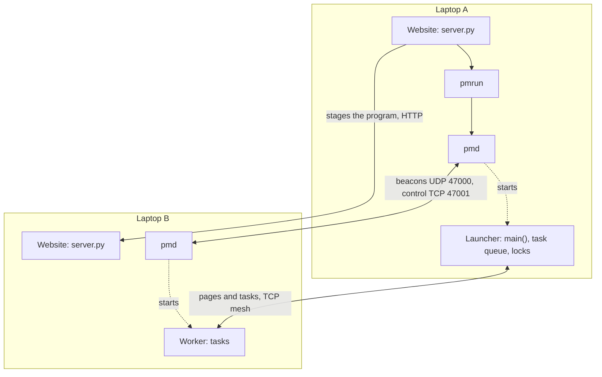
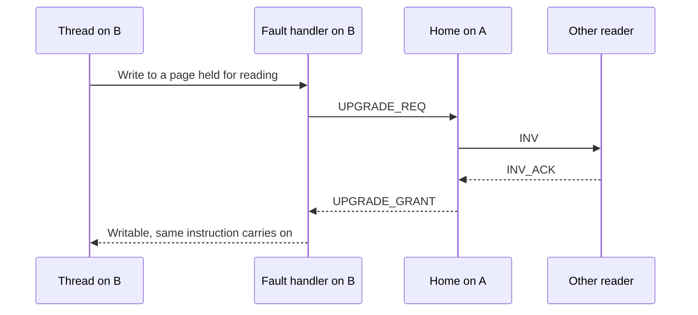
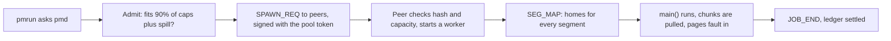
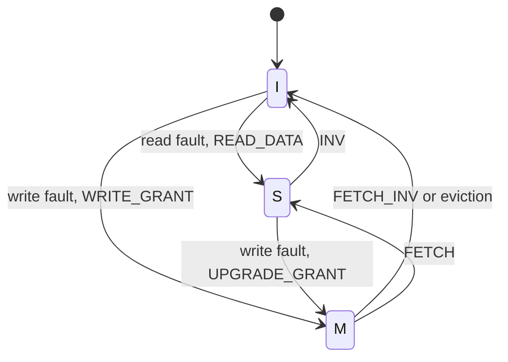
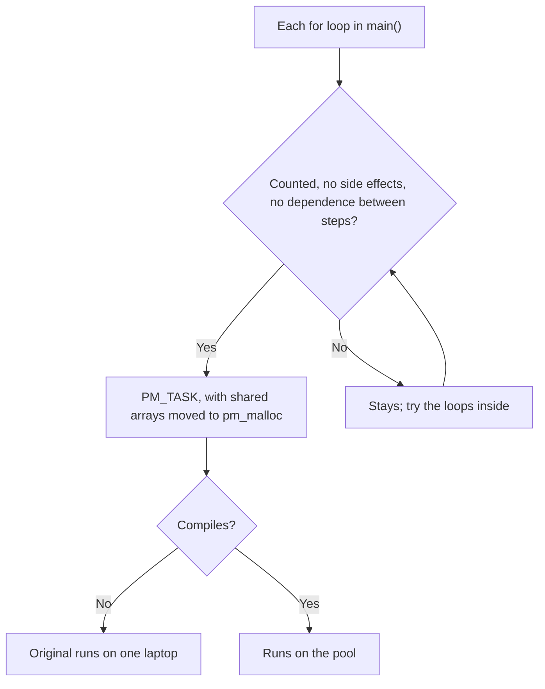

# ParaMesh design

ParaMesh runs one C program across several Linux laptops, with one shared memory and no socket code in
the program. This document describes the system as built. Part 1 is the high-level design, and part 2
the low-level design. The wire format, state machines and interfaces are specified in full in
[`PROTOCOL.md`](PROTOCOL.md), [`STATE_MACHINES.md`](STATE_MACHINES.md) and
[`INTERNAL_API.md`](INTERNAL_API.md).

# Part 1: high-level design

## 1. Goals and limits

| Goal | How it is met |
| --- | --- |
| Ordinary programs | A C API, or plain C through the translator. Applications never touch a socket. |
| Use many laptops | Each laptop gives capped cores and RAM to a pool found by discovery or invite. |
| Never a wrong answer | Coherence keeps one writer at a time. Lost data ends the job; it is never zero-filled. |
| Fair sharing | A ledger each node keeps itself weights who gets free slots. |
| A changing pool | Nodes can join a running job and leave one in order. |

It is for a trusted network. It has no encryption, and it does not survive a crash of a node in a job.

## 2. System view

- **`pmd`**, one per laptop, is the long-lived daemon. It discovers peers, admits jobs, picks nodes, starts
  workers, keeps the ledger, shares slots, and serves the status API.
- **A job** is the same executable on each node. The **launcher** runs `main()` and holds the task queue
  and the locks. **Workers** stay inside `pm_init()` and run tasks. `libparamesh` lives in each process.
- **`pmrun`** asks the local `pmd` for N nodes. **`pm`** shows status and leaves.
- **The website** is a Python server on each laptop: home page, playground and dashboard.

## 3. Shared memory

Every job process maps the same region at the same fixed address, so a pointer means the same on every
node. The region is cut into 2 MiB segments, each with a **home** chosen by RAM-weighted rendezvous hashing.
Pages are 4096 bytes.

A page a node does not hold is not mapped. Touching it raises a fault through `userfaultfd`. A handler
thread asks the home, installs the bytes, and wakes the thread, which repeats its instruction. Pages held
for reading are write-protected, so the first write faults too.

Coherence is write-invalidate: many readers or one writer. Before a write is granted, the home invalidates
every other copy.

## 4. Tasks

`pm_parallel_for` cuts a range into chunks, page-aligned where the data allows. The launcher queues them,
and idle worker threads pull. A pull queue balances load by itself: a fast node asks more often. A chunk
prefers the node that is home for its pages. A task must be safe to run twice, because a leaving node's
unfinished chunks run again.

## 5. A job's life

## 6. Fairness

Inside a job, the pull queue shares work. Between jobs, each `pmd` gives its worker slots at task
boundaries in this order: a job left without a slot, this node's own jobs, then the guest job with the lowest dominant
share divided by its weight:

`w = max(0.25, 1 + balance / ledger.scale)`

A node's balance is what it has provided to a peer less what it has received, by this node's own count. What
a peer announces is shown and compared, but never feeds a weight, a quota or an admission decision. A node that
gives nothing falls to the floor of 0.25, and is slowed but not starved.

In the website, each machine holds one place in a laptop's line, so machines take turns. Turns are per
machine and per laptop, not per person, and not across the pool.

## 7. Changes to the pool

A planned leave (`pm leave`) stops new tasks, gives running ones 10 s, writes modified pages back, moves
homes with a new `SEG_MAP`, and the job carries on. A job running on fewer nodes than it asked for is offered
to a newly seen peer. A crash, or 3 s of silence, ends the job everywhere and names the node.

## 8. Safety

| Threat | Defence |
| --- | --- |
| A stranger starts a program | `SPAWN_REQ` carries a tag made with the pool token; a node with a token declines others. |
| Code from a visitor | Landlock, seccomp and rlimits on compile and job. The translator runs sandboxed too. It fails closed. |
| Website access | The access code for other machines, runs private to a machine, a lockout on wrong guesses. |
| A different program | Each node hashes the executable and declines a mismatch. |
| A lying peer | Received values never feed a weight, a quota or an admission. |

The access code and token still cross the LAN in plain HTTP, and a copied request can be replayed.

# Part 2: low-level design

## 9. Source layout

Dependencies run one way; a directory never includes one that depends on it.

| Directory | Holds |
| --- | --- |
| `include/paramesh.h` | The public C API. Frozen. |
| `src/platform/` | Interfaces and adapters: hash, checksum, JSON, HTTP, log, clock, config, sandbox. |
| `src/wire/` | Frame header, opcodes, payload encoding. No sockets. |
| `src/coh/` | Node and home state machines. Pure: no system calls and no clock. |
| `src/mem/` | Region mapping, userfaultfd, install, zap, write-protect. |
| `src/store/` | Home store, CLOCK eviction, spill file, local cache, placement. |
| `src/net/` | epoll loop, TCP mesh, timers, heartbeats. |
| `src/rt/` | Task registry, queue, workers, locks, barriers, atomics, allocator. |
| `src/lib/` | Joins the above into `libparamesh`. |
| `src/pmd/` | The daemon: discovery, admission, spawn, ledger, slots, status API, pool key. |
| `src/tools/` | `pm` and `pmrun`. |
| `tools/playground/` | `server.py`, and `translate.py`, the translator. |
| `tools/site/` | The website. Plain HTML, CSS and JavaScript. |
| `tools/setup/` | Packaging and the installer. |
| `tests/` | Unit tests (doctest), a simulated bus with a fuzzer, and multi-node scripts. |

## 10. Threads of a job process

| Thread | Waits on | Does |
| --- | --- | --- |
| Fault handler | userfaultfd and an eventfd | Starts requests for faulting pages. |
| Network | epoll | Reads frames, drives the state machines, heartbeats and timers. |
| Workers | task queue | Run chunks. |
| Launcher main | the application | Runs `main()`; only here does `pm_malloc` work. |

Neither the handler nor the network thread takes a lock that a blocking thread can hold.

## 11. State machines

`src/coh/` takes events and returns actions, so it can be fuzzed with no network.

The node also has four in-flight states. The home keeps a directory entry per page:

| Field | Meaning |
| --- | --- |
| `state` | `UNCACHED`, `SHARED` or `EXCLUSIVE` |
| `where` | The home's copy: `ZERO`, `RAM`, `SPILL` or `NONE` |
| `owner`, `copyset` | The exclusive holder, and who may hold a copy |
| `version` | Raised on each write grant or atomic |
| `op`, `waitq` | One operation at a time per page, and requests behind it |
| `hold` | The hold window against page fights |

An event that should be impossible aborts the job rather than guess.

## 12. Wire format

Each message is a frame: a 36-byte header with opcode, job, source, destination, request ID and checksum,
then the payload. Peers fetch pages over one TCP mesh per job. A request has a 2 s reply timeout with one retry.
Heartbeats go every 1 s, and 3 s of silence loses the peer. Opcodes are listed in `PROTOCOL.md`.

## 13. Memory limits

`--cap-ram` bounds a node's home store and local cache together. The home evicts by CLOCK to a spill file.
The local cache evicts first in, first out by default, and a modified page is written back first. Each node commits its share
of a job's region at admission, so a job that cannot fit is refused rather than failing midway.

## 14. Performance features

| Feature | What it does |
| --- | --- |
| Prefetch | Three read faults one stride apart start a stream; up to 4 streams, up to 8 pages ahead. |
| Page encoding | A word map leaves out zero words of a page, or of its XOR with a kept copy, when that is smaller. It is not a general compressor. |
| Hold window | A page two nodes fight over stays put for a short time, so work gets done between moves. |
| Hold for readers | The same for read-write fights (`thrash.hold_readers`). |
| Re-homing | Optional: a segment used mostly by one node moves there (`rehome.period_ms`, off by default). |
| Locality scheduling | A node gets the chunk with most of its pages, or helps the home whose queue would take longest. |
| Cache policy | FIFO by default, or cost-based over the 8 oldest pages. |

## 15. Translator

`translate.py` reads C with patterns, not a parser, so it splits only what it can show to be safe.

A variable a loop only adds to or multiplies becomes a total, kept in a shared cell behind a lock. Scratch
variables set before use become private. A loop stays if it prints, allocates, uses `rand()` or `break`, depends
on an earlier step, writes one place from two steps, updates an array in place, uses a struct, passes a shared
pointer to unknown code, or calls a function that may have side effects.

## 16. Website

`server.py` uses only the Python standard library. A run goes: check, line, translate, compile under `pm sandbox`,
stage to peers with a SHA-256 check, `pmrun`, collect `job_pages` from each process, record. Pages poll the
JSON API. The dashboard reads `pmd`'s status API on 127.0.0.1.

## 17. Testing

| Layer | What runs |
| --- | --- |
| Unit | doctest, one file per source directory, in GCC and Clang. |
| Sanitizers | Address, undefined-behaviour and thread, in CI. |
| Simulation | A fake bus and fuzzer drive the state machines against invariants. |
| Multi-node | Scripts on localhost and in network namespaces, with delay and loss. |
| Playground | End-to-end checks, and each translated program compared with a plain `gcc` build. |
| Gate | clang-format, clang-tidy, warnings as errors, and an implementation log for each change. |

## 18. Measured results

| Measure | Result | Where |
| --- | --- | --- |
| Matrix multiply, n = 4096, simulated nodes on one machine | 1 node 8.22 s, 2 nodes 6.82 s (1.21×), 3 nodes 7.72 s (1.06×) | M3 gate |
| Fairness, three equal jobs | Jain's index 0.996 | M5 gate |
| Free-rider over 10 rounds | Weight 0.96 to 0.60, share 0.21 to 0.14, never 0 | M5 gate |
| Fault latency alone, 896 remote reads | p50 293.7, p90 561.1, p99 737.0 µs | M5 gate |

These figures come from simulated nodes on one machine. Real-laptop results are in the README.
Rare unexplained test failures are listed in [`TODO.md`](TODO.md).
